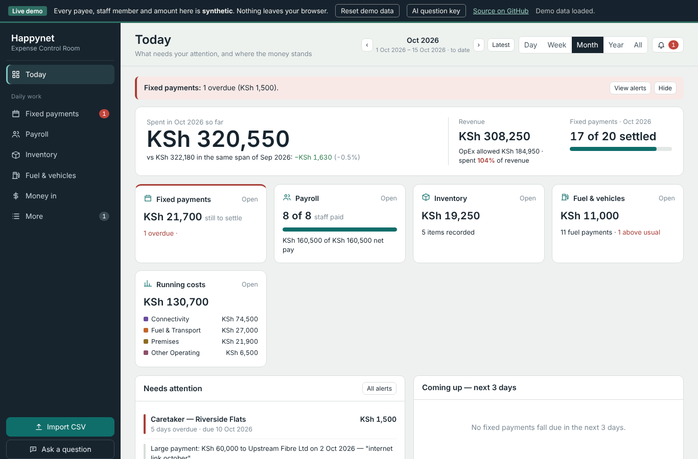

# Expense Control Room

A React app that turns raw payment exports from a business wallet into a classified expense register, a bill calendar, payroll checks and management reports. I built it for **HappyNet Internet Services**, a Kenyan ISP, where every business payment goes out through **Tende** wallets and M-Pesa.

### ▶ [Try the live demo](https://kaliumg432-hub.github.io/expense-control-room/)

The demo runs on **synthetic data**. Every staff member, payee, phone number and amount is invented, and nothing leaves your browser.



---

## The problem

The business pays for everything from several Tende wallets: payroll, inventory, internet links and rent, and a float for day-to-day costs. The exports list every payment with a free-text remark, often misspelt ("tenda rooter", "p cord", "spritter 1 8"). Answering these questions took hours by hand:
- Where did the money go this month?
- Has rent been paid?
- Did everyone get their salary?
- Did router prices go up?

## What the app does

Import one or more Tende CSV exports, plus M-Pesa revenue statements, and the app does the rest.

| Screen | What it shows |
|---|---|
| **Today** | Spending so far against the same days last month, revenue, bills settled, and anything that needs attention |
| **Fixed payments** | A calendar of rent, links, caretakers and other scheduled bills, each matched to the Tende payment that settled it, or flagged as overdue |
| **Payroll** | Who has been paid this month and who hasn't, with net pay worked out from gross, additions, advances and deductions |
| **Inventory** | What was bought, how many and at what unit cost, with price rises flagged against a supplier price list |
| **Fuel & vehicles** | Car and motorbike fuel checked against the usual amounts |
| **Money in** | Revenue from M-Pesa statements, the Profit First operating budget, and a cash plan |
| **All expenses** | Every payment, searchable and filterable, with a full edit history for every correction |
| **Analysis** | Where the money went, month-on-month comparisons and trends |
| **Reports** | Daily, weekly and monthly summaries ready to share |
| **Needs checking** | Possible duplicates, unusual amounts and data-quality checks |

## How it works

**1. Sorting payments into types.** Each row is identified as an **expense**, a **transfer between the company's own wallets**, **money in**, or a **failed, reversed or pending** payment. Transfers are paired across the two wallets by reference, or by amount and time, so moving money is never counted as spending.

**2. Cleaning the remarks.** A set of spelling rules standardises the free text before anything is read. For example, "spritter", "splinter" and "spliter" all become *splitter*, and "spritter 1 8" becomes *splitter 1:8*. The original remark is always kept.

**3. Assigning categories.** Ordered rules give each expense a category and subcategory, such as *Inventory & Equipment → Routers* or *Fuel & Transport → Bike fuel*. Each one gets a confidence level:
- **High:** the remark and the wallet it was paid from agree.
- **Medium:** only a general keyword matched, or the wallet is unusual for that category.
- **Unclassified:** nothing matched, so it goes to review.

**4. Reading quantities.** Remarks like "5 tenda routers" or "fat box 1:8 4 pcs" become item, quantity and unit cost. The app splits payments covering several items using the price list, and flags a price well above usual.

**5. Matching bills.** Each scheduled bill is matched to a payment by payee, keyword and expected amount. The rules handle:
- late fees
- amounts that alternate month to month
- bills due every few months
- "same as last month" amounts

**6. Matching payroll.** Salaries are matched by employee name or phone, using the month named in the remark, so a September salary paid on 5 October counts against September's run.

**7. Keeping your edits.** Raw rows are stored untouched. Every manual correction is saved separately with who made it, when and why, so re-importing never loses work.

## The question panel

The **Ask a question** panel uses the Claude API for plain-language questions like "How many routers did we buy and at what unit cost?" or "Which fixed payments are overdue?".

The AI never adds up the money itself. It replies with structured `<query>` requests, the app runs them exactly on the classified payments, and the AI writes its answer from those results. Each answer also lists the payments behind it, so every figure can be checked. This is the same design as the companion [customer analytics app](https://github.com/kaliumg432-hub/isp-customer-analytics).

> The public demo needs **your own Anthropic API key** for this panel. Paste it via "AI question key" in the demo bar. It is kept only in the tab's memory and is never saved. Every other screen works without a key.

## About the demo version

The app's built-in defaults were the company's real payment calendar and payroll. For this public version they have been replaced with **invented staff, payees and amounts** that follow the current month, so the calendar and alerts are always live. The logic is unchanged, apart from swapping a few real names and IDs in help text and examples for generic ones.

## Repository contents

| File | What it is |
|---|---|
| `index.html` | The live demo, built into one self-contained file |
| `happynet-expense-control.jsx` | The app, with demo defaults instead of real company data |
| `main.jsx` | Demo wrapper: browser storage, demo data loader, API key handling |
| `demo_tende_payments_2026-*.csv` | Four months of synthetic Tende wallet exports |
| `demo_utility_statement_2026-*.csv` | Four months of synthetic M-Pesa revenue statements |
| `make_sample_data.py` | The script that generates all the synthetic data |
| `build.mjs` | Builds `index.html` with esbuild |

## Running it yourself

```bash
npm install
npm run build      # writes index.html
```

Then open `index.html` in a browser. To regenerate the sample data, run `python3 make_sample_data.py`.

## Built with

React 18 · Recharts · PapaParse · Claude API · esbuild

See also: [ISP Customer Analytics](https://github.com/kaliumg432-hub/isp-customer-analytics), the companion app for the revenue side.
